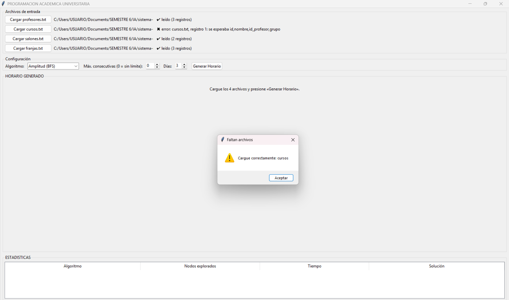
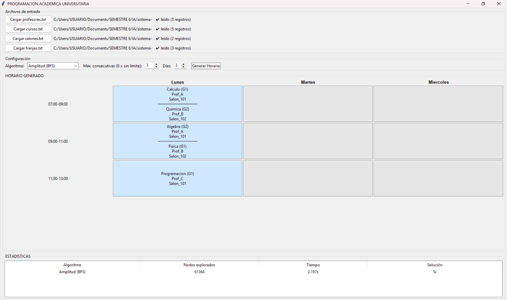
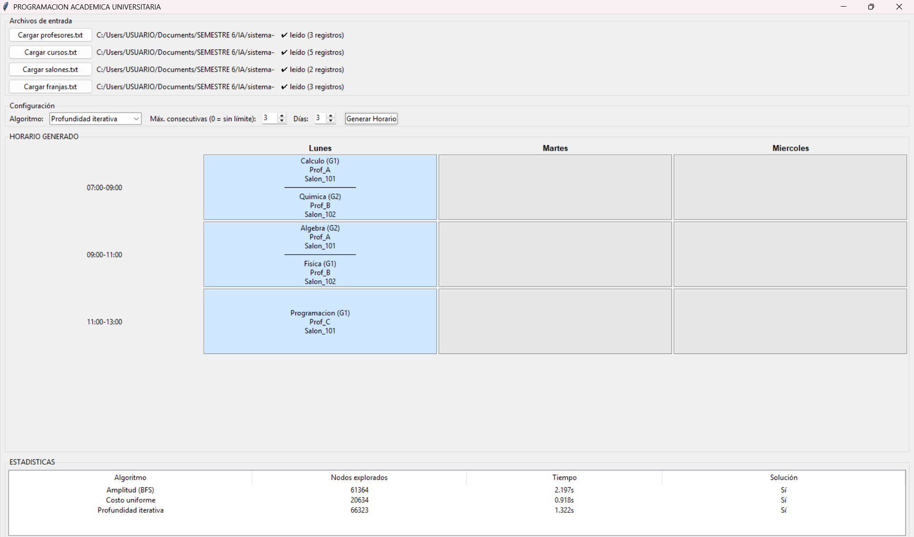
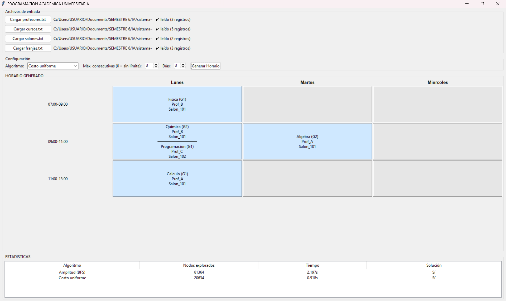
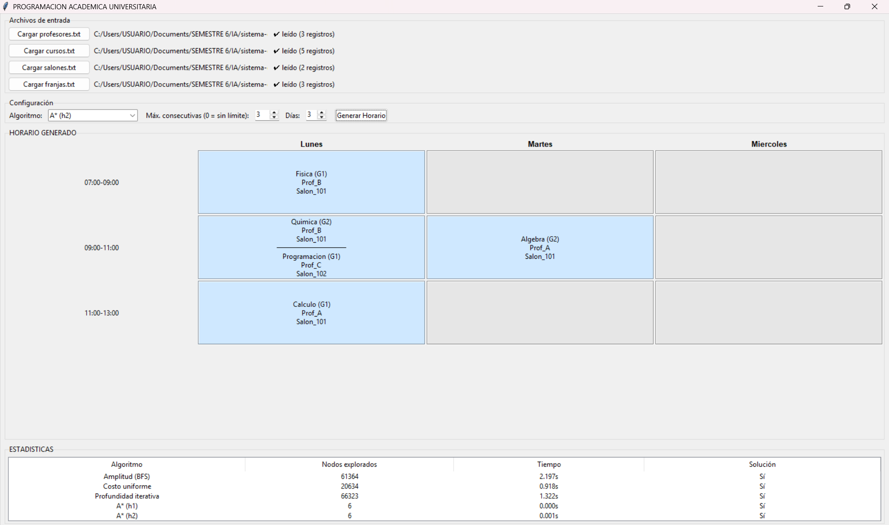
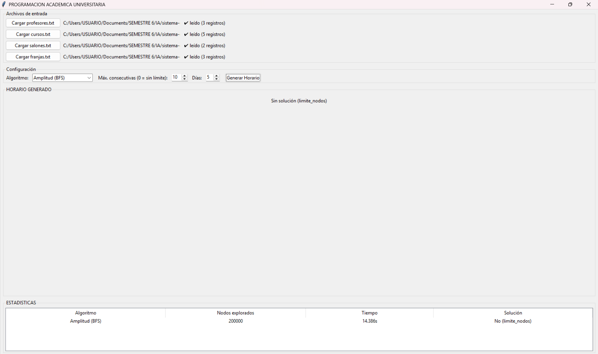

# Informe — Sistema de asignación de horarios


* Santiago Andrey Morales Valencia - 2380753  
* Dilan Joseph Sanchez Silva - 2380492
* Valentina Betancourt Caicedo - 202459411

---

## 1. Introducción

El objetivo del proyecto es armar automáticamente el horario de una institución:
decidir **qué día, a qué hora y en qué salón** se dicta cada clase, de modo que no
haya choques (un mismo profesor, un grupo o salón en dos lugares a la vez) intentando respetar las preferencias de los profesores y que no se sobrecargue a los grupos.

Para resolverlo, planteamos el problema como una **búsqueda en un árbol**: la idea es partir de un
horario vacío y poco a poco ir ubicando una clase a la vez hasta tener el horario completo.

---

## 2. Datos del problema

| Elemento   | Qué representa                                        | Ejemplo                    |
|------------|-------------------------------------------------------|----------------------------|
| `Franja`   | Un bloque de horas dentro del día (sin el día)        | `07:00-09:00`              |
| `Salon`    | Un salón disponible                                   | `S1`                       |
| `Profesor` | Un docente y las franjas en las que **no** puede dictar | `Prof_A`, no puede Lunes 07:00 |
| `Clase`    | Una sesión que hay que programar (materia, profesor, grupo) | Cálculo, Prof_A, G1   |

Si una materia tiene varias sesiones a la semana, cada sesión se trata como una `Clase`
distinta (por ejemplo `Calculo-1` y `Calculo-2`).

---

## 3. Representación del estado

La idea es sencilla: **un estado es un horario a medio construir.**

Se representa como una lista con una posición por cada clase. En cada posición hay:

- la **asignación** de esa clase, es decir, la tripleta $(\text{día},\ \text{franja},\ \text{salón})$, o
- `None` si esa clase todavía no se ha ubicado.

Formalmente, si hay $n$ clases:

$$
\text{Estado} = (a_1, a_2, \dots, a_n), \qquad
a_i =
\begin{cases}
\text{None} & \text{si la clase } i \text{ aún no se ha ubicado} \\
(d,\ f,\ s) & \text{si ya se ubicó}
\end{cases}
$$

donde $d$ es un día de $D$ (conjunto de días), $f$ una franja de $F$ (conjunto de franjas)
y $s$ un salón de $S$ (conjunto de salones).

Dicho de otra forma: el conjunto de **todas las tripletas posibles** se escribe
$D \times F \times S$ (todas las combinaciones de un día, una franja y un salón), y cada
posición del estado toma **un valor de ese conjunto o el valor `None`**. Por eso también se
puede escribir de forma compacta como $a_i \in \{\text{None}\} \cup (D \times F \times S)$,
donde la unión $\cup$ significa simplemente “o una cosa o la otra”.

**Ejemplo** con 4 clases, después de dos pasos:

```
( (Lunes, 07:00-09:00, S1),  (Lunes, 09:00-11:00, S1),  None,  None )
     Cálculo                    Álgebra                  Física Química
```

### Elementos del problema

| Elemento            | Definición                                                                 |
|---------------------|----------------------------------------------------------------------------|
| **Estado inicial**  | Todas las posiciones en `None` (horario vacío).                            |
| **Operador**        | Asignar a la siguiente clase libre una tripleta (día, franja, salón).      |
| **Sucesores**       | Solo se generan las asignaciones que **no** producen choques.             |
| **Prueba de meta**  | Ninguna posición es `None` (todas las clases quedaron ubicadas).           |
| **Costo**           | Cada asignación cuesta 1 más una penalización si incumple alguna preferencia (ver sección 5). |

### ¿Por qué esta representación?

- **Es fácil de entender y de verificar:** Si miramos la posición $i$ vamos a saber dónde quedó la clase $i$.
- **Cada clase se asigna exactamente una vez** por cómo está construida la lista; no hace falta revisarlo aparte.
- **Los estados no se pueden modificar después de creados** (son inmutables). Cada paso genera un estado nuevo, así que dos nodos del árbol nunca se “pisan” entre sí. Esto también permite compararlos y guardarlos en conjuntos.
- **Las clases se asignan siempre en el mismo orden** (primero la clase 1, luego la 2, …). Entonces a cada horario se llega por un único camino y no aparecen estados repetidos que solo cambian el orden en que se ubicaron las clases.

---

## 4. Restricciones

### 4.1 Restricciones duras (nunca se pueden romper)

En una misma franja **del mismo día**:

1. Un **salón** no puede tener dos clases.
2. Un **profesor** no puede dictar dos clases.
3. Un **grupo** no puede tener dos clases.
4. Cada clase se programa **exactamente una vez** (lo garantiza la representación).

Estas restricciones se aplican **al generar los sucesores**: si una asignación produce un
choque, ese hijo simplemente no se crea. Por eso todo horario completo que encuentre la búsqueda ya es válido.

### 4.2 Restricciones blandas (se pueden romper, pero cuestan)

| Restricción                                                   | Penalización |
|---------------------------------------------------------------|:------------:|
| (a) El profesor dicta en una franja que marcó como no disponible | $+5$ por cada clase |
| (b) Un grupo tiene más de $N$ clases seguidas el mismo día      | $+3$ por cada clase que pase el límite |

Para la (b), si un grupo tiene una racha de $r$ clases seguidas y el máximo permitido es $N$,
el exceso de esa racha es $\max(0,\ r - N)$. Por ejemplo, con $N = 2$ y cuatro clases seguidas,
el exceso es $2$ y la penalización es $2 \times 3 = 6$.

### 4.3 Detalle de implementación: revisión rápida de choques

Antes de generar los hijos de un nodo, se construye **una sola vez** un índice (`Ocupacion`)
con lo que ya está ocupado: qué salones, profesores y grupos están usados en cada día y franja.
Con ese índice, comprobar si un candidato choca es una consulta directa en un conjunto, sin
recorrer todo el horario cada vez.

Además existe una función de **verificación independiente** (`verificar_completo`) que revisa
todas las restricciones duras comparando las clases de dos en dos. No depende de cómo se generan
los sucesores, así que la usamos en las pruebas para comprobar que los algoritmos no se equivocan.

---

## 5. Función de costo

Cada paso (ubicar una clase) cuesta:

$$
c(\text{paso}) = 1 + \text{penalización blanda que genera ese paso}
$$

Por lo tanto, el costo total $g$ de un horario completo es:

$$
g(\text{horario}) = n + P
$$

donde $n$ es el número de clases y $P$ la penalización total por restricciones blandas.

Como $n$ es igual para todos los horarios completos, **minimizar $g$ es lo mismo que minimizar
las violaciones de preferencias.** Un costo de $g = n$ significa un horario perfecto, sin
penalizaciones.

> **Justificación:** el costo base de 1 hace que todos los pasos cuesten algo positivo, que es
> justo lo que necesita la búsqueda de costo uniforme para funcionar bien. Los pesos (5 y 3)
> reflejan que es más grave poner a un profesor en un horario donde no puede que darle a un
> grupo una clase seguida de más. Los pesos se pueden cambiar al crear el problema.

---

## 6. Espacio de búsqueda

- **Factor de ramificación** $b$: cuántos hijos puede tener un nodo como máximo. Es el número de
  tripletas posibles:

$$
b = |D| \times |F| \times |S|
$$

- **Profundidad de la solución** $d$: siempre igual al número de clases, $d = n$, porque cada
  nivel del árbol ubica una clase.

- **Tamaño máximo del árbol** (si no se descartara ningún choque):

$$
1 + b + b^2 + \dots + b^n = \sum_{k=0}^{n} b^k \approx b^n
$$

**Ejemplo:** con 2 días, 3 franjas y 2 salones, $b = 2 \times 3 \times 2 = 12$. Con 4 clases,
el árbol completo tendría $\sum_{k=0}^{4} 12^k = 22\,621$ nodos. Gracias a que los choques se
descartan al generar los hijos, en la práctica BFS crea solo $9\,013$ nodos (≈ 40 %).

El tamaño crece **exponencialmente** con el número de clases: agregar una clase multiplica el
árbol aproximadamente por $b$. Por eso estos algoritmos solo son prácticos en instancias pequeñas,
y se agregaron **límites de nodos (200 000) y de tiempo (30 s)** para que la interfaz no se congele.

---

## 7. Algoritmos implementados

Los algoritmos siguen las reglas que vimos en clase:

- La **prueba de meta** se hace al **sacar** un nodo de la frontera (al expandirlo), no al crearlo.
- **Nodos expandidos** = nodos sacados de la frontera, incluido el nodo meta.
- **Nodos creados** = nodos que entran al árbol, incluida la raíz.
- Si se alcanza un límite, el resultado indica el motivo (`limite_nodos` o `limite_tiempo`);
  si el árbol se agota sin encontrar meta, el motivo es `sin_solucion`.

### 7.1 Búsqueda preferente por amplitud (BFS)

Explora el árbol **por niveles**: primero todos los horarios con 1 clase ubicada, luego todos
los de 2, y así sucesivamente. Usa una **cola FIFO** (el primero que entra es el primero que sale).

- **Completa:** si existe un horario válido, lo encuentra.
- **No es óptima en este problema:** BFS no mira los costos, así que devuelve el *primer*
  horario válido que encuentra, aunque tenga penalizaciones. Solo sería óptima si todos los
  pasos costaran lo mismo.
- **Complejidad:** tiempo y memoria $O(b^d)$.

### 7.2 Búsqueda de costo uniforme (UCS)

Siempre expande el nodo con **menor costo acumulado $g$**. Usa una **cola de prioridad**.

- **Completa y óptima:** como todos los pasos cuestan al menos 1, el primer horario completo
  que sale de la frontera es el de **menor costo**, en otras plabras el que menos preferencias incumple.
- Cuando dos nodos tienen el mismo costo, se desempata por orden de llegada, así que el
  resultado es siempre el mismo al repetir la búsqueda.
- Si no hay restricciones blandas (todos los pasos cuestan 1), se comporta igual que BFS.
- **Complejidad:** $O\!\left(b^{\,1 + \lfloor C^*/\varepsilon \rfloor}\right)$, donde $C^*$ es el
  costo de la solución óptima y $\varepsilon = 1$ el costo mínimo de un paso.

### 7.3 Búsqueda por profundidad iterativa (IDS)

IDS ejecuta búsquedas en profundidad limitadas, aumentando el límite de profundidad
sucesivamente: primero 0, luego 1, 2, etc., hasta encontrar una meta o agotar el árbol.
Cada iteración usa una pila implícita de llamadas recursivas y vuelve a visitar los nodos
de niveles anteriores. En esta implementación, el contador de nodos expandidos y los límites
de tiempo y nodos se mantienen entre iteraciones.

- **Completa** en este problema finito si no se alcanzan los límites de tiempo o nodos:
  si existe una solución, IDS alcanza su profundidad.
- **No garantiza el menor costo:** encuentra una solución de profundidad mínima, pero todas
  las soluciones completas asignan la misma cantidad de clases. Por eso puede devolver un
  horario con más penalizaciones que UCS o A*.
- **Complejidad:** tiempo $O(b^d)$ y espacio $O(bd)$, donde $b$ es el factor de ramificación
  y $d$ la profundidad de la solución. El espacio es menor que el de BFS, a costa de repetir
  expansiones en las iteraciones sucesivas.

### 7.4 Búsqueda A*

A* mantiene una cola de prioridad y expande el nodo con menor valor:

$$
f(n) = g(n) + h(n)
$$

$g(n)$ es el costo acumulado de las asignaciones realizadas y $h(n)$ estima el costo mínimo
que falta para completar el horario. La implementación ofrece dos variantes, A* (h1) y
A* (h2), descritas en la sección 8. Los nodos cuya heurística es infinita se descartan:
representan estados parciales desde los que ya no es posible completar todas las clases.

- **Óptima** con estas heurísticas: se expanden nodos por $f$ y la primera meta extraída de
  la frontera tiene costo mínimo. Los empates se resuelven por menor $h$ y luego por orden
  de inserción, lo que hace determinista el resultado.
- En este problema se asigna siempre la primera clase libre, por lo que cada estado tiene
  un único camino en el árbol; no se necesita una lista de estados visitados.
- **Complejidad:** en el peor caso exponencial, como las demás búsquedas del árbol; su
  rendimiento práctico depende de cuánto logre orientar la heurística.

---

## 8. Heurísticas

Las heurísticas de `heuristicas.py` estiman el costo que falta para completar un estado.
Cada clase que aún no tiene asignación necesita al menos un paso, cuyo costo base es
`problema.costo_base`. Como las penalizaciones blandas nunca son negativas, ignorarlas
produce una cota inferior del costo restante.

### 8.1 Heurística h1

$$
h_1(n) = |\text{clases sin asignar en }n| \times \text{costo\_base}
$$

h1 cuenta un costo base por cada clase pendiente y supone, de manera optimista, que ninguna
asignación futura tendrá penalizaciones. Por eso nunca sobreestima el costo real que falta:
es **admisible**. También es consistente, ya que cada paso reduce h1 exactamente en el costo
base y cuesta al menos esa cantidad. En un estado completo vale 0.

### 8.2 Heurística h2

h2 calcula el mismo valor que h1 cuando cada clase pendiente conserva por lo menos una
asignación que respeta las restricciones duras. Si encuentra una clase pendiente sin ningún
valor legal, devuelve infinito. Esa rama no puede conducir a una solución: las asignaciones
posteriores solo agregan ocupaciones y no pueden volver legal un valor que ya está bloqueado.
Así A* puede podarla sin perder soluciones. En los estados que sí pueden continuar, h2 conserva
la cota inferior admisible de h1.

### 8.3 Comparación y uso en A*

En estados viables, las dos heurísticas tienen el mismo valor. h2, además, devuelve infinito
cuando detecta que alguna clase pendiente no tiene valores legales y permite podar esos
callejones sin salida. UCS equivale a ordenar por $g$ (heurística cero), mientras que A* ordena por
$g+h$ y prioriza los estados que combinan bajo costo acumulado con menor costo restante.
En la instancia de cinco clases mostrada en la sección 14, ambas variantes de A* expandieron
6 nodos; ese caso no permite observar una ventaja de h2 sobre h1, aunque h2 sí puede podar
estados inviables, como comprueba la prueba correspondiente.

---

## 9. Pruebas

Las pruebas automáticas están en `test_parte_a.py` y se ejecutan con:

```bash
python -m unittest test_parte_a
```

### 9.1 Pruebas del núcleo y de los algoritmos

| Prueba | Qué comprueba |
|--------|---------------|
| `test_estado_inicial_y_sucesores_legales` | El estado inicial no es meta y genera $2 \times 3 \times 2 = 12$ hijos, cada uno con costo 1. |
| `test_no_se_generan_conflictos` | Una clase del mismo profesor no se ubica en la misma franja y día, pero sí en la misma franja otro día. |
| `test_valores_legales_y_variable_dinamica` | Los valores legales se reducen al ir asignando, y se puede elegir qué clase asignar (útil para otras estrategias). |
| `test_bfs_y_ucs_encuentran_horario_valido` | BFS, UCS e IDS encuentran un horario que pasa la verificación independiente sin errores. |
| `test_bfs_expande_por_niveles` | Con 1 clase, BFS expande 2 nodos y crea 7 (raíz + 6 hijos), como se espera. |
| `test_sin_solucion` | Si es imposible (2 clases del mismo profesor y 1 sola franja), BFS, UCS e IDS responden `sin_solucion`. |
| `test_iddfs_respeta_limite_nodos_dentro_de_una_iteracion` y `test_iddfs_respeta_limite_tiempo_durante_una_iteracion` | IDS detiene la búsqueda y reporta correctamente el límite alcanzado. |
| `test_iddfs_detecta_agotamiento_al_llegar_al_limite_de_nodos` | IDS informa `sin_solucion` si agota el árbol justo al alcanzar el límite, en vez de confundirlo con una búsqueda truncada. |
| `test_limite_de_nodos` | Al alcanzar el límite de nodos, la búsqueda se detiene e informa `limite_nodos`. |
| `test_ucs_optimo_blandas_no_disponible` | UCS evita las franjas no disponibles del profesor y logra costo 4 (sin penalización). |
| `test_ucs_menor_o_igual_que_bfs` | El costo de UCS nunca es mayor que el de BFS. |
| `test_ucs_es_el_minimo_global_por_fuerza_bruta` | Se prueban **todas** las combinaciones posibles y el mejor costo coincide con el de UCS. |
| `test_costo_acumulado_igual_a_costo_total` | El costo sumado paso a paso es igual al costo calculado sobre el horario final. |
| `test_heuristicas_cuentan_clases_pendientes` | h1 y h2 asignan la cota base esperada según la cantidad de clases aún libres. |
| `test_a_estrella_h1_y_h2_encuentran_solucion_optima` | Ambas variantes de A* encuentran un horario válido con el costo mínimo obtenido por UCS. |
| `test_a_estrella_h2_poda_y_cuenta_hijos_sin_valores_legales` | h2 devuelve infinito para un callejón sin salida y A* lo poda sin expandirlo. |
| `test_a_estrella_esta_registrada_con_firma_de_la_interfaz` | Las dos variantes de A* están registradas para su uso desde la interfaz y respetan sus parámetros. |

Resultado: **todas las pruebas pasan.**

### 9.2 Resultados de las pruebas

Las pruebas usan una instancia pequeña: 4 clases, 2 profesores, 2 grupos, 2 días, 3 franjas
y 2 salones. Como hay 4 clases, un costo de $g = 4$ significa un horario **sin ninguna
penalización**.

| Prueba | Costo BFS | Costo UCS | Nodos creados BFS | Nodos creados UCS |
|---|:---:|:---:|---:|---:|
| `encuentran_horario_valido` (sin preferencias) | 4 | 4 | 9 013 | 9 013 |
| `optimo_blandas_no_disponible` | 14 | **4** | 9 013 | 645 |
| `menor_o_igual_que_bfs` | 20 | **4** | 9 013 | 1 441 |
| `costo_acumulado_igual_a_costo_total` | 20 | **4** | 9 013 | 2 885 |
| `minimo_global_por_fuerza_bruta` | 9 | **9** | 223 | 159 |

En las demás pruebas: `sin_solucion` responde correctamente que no hay horario posible,
`limite_de_nodos` se detiene al llegar al límite, y `expande_por_niveles` crea los 7 nodos
esperados (la raíz y sus 6 hijos).

---

## 10. Análisis de resultados

1. **Los dos algoritmos siempre entregan horarios válidos.** En todas las pruebas donde existe
   solución, el horario encontrado pasa la verificación independiente sin ningún choque. Esto
   confirma que descartar los choques al generar los hijos funciona correctamente.

2. **BFS encuentra un horario válido, pero no el mejor.** Cuando hay preferencias que respetar,
   BFS devuelve el primer horario completo que encuentra sin importar su costo. Por ejemplo, en
   `optimo_blandas_no_disponible` pone a Prof_A dos veces en franjas donde no puede
   (penalización 10), y en `menor_o_igual_que_bfs` además deja a los dos grupos con clases
   seguidas (penalización 16).

3. **Costo uniforme sí encuentra el mejor horario.** En esas mismas pruebas, UCS logra
   penalización **0** ($g = n = 4$). La prueba de **fuerza bruta** lo confirma: se revisaron
   las $6^4 = 1\,296$ combinaciones posibles, de las cuales solo 120 son válidas, y el menor
   costo entre ellas es 9, exactamente el que encontró UCS. En ese caso **no existe un horario
   perfecto**: Prof_A tiene dos clases y solo una franja disponible, así que una penalización
   de 5 es inevitable. Ahí BFS también llegó a costo 9, pero por casualidad, no porque lo
   garantice.

4. **Sin preferencias, BFS y UCS hacen lo mismo.** En `encuentran_horario_valido` todos los
   pasos cuestan 1, así que UCS se comporta igual que BFS: mismos nodos y mismo resultado.

5. **UCS además exploró menos nodos.** Cuando hay preferencias, UCS siempre creó menos nodos
   que BFS, **hasta 14 veces menos** (645 contra 9 013). La razón es que BFS revisa niveles
   completos del árbol antes de llegar al último, mientras que UCS avanza primero por los
   caminos baratos y, si existe un horario perfecto, lo alcanza pronto. Si todas las
   soluciones fueran caras, esta ventaja sería menor.

6. **Los casos límite se manejan bien.** Cuando no hay solución posible, ambos algoritmos
   recorren el árbol completo (solo 3 nodos, porque los choques se detectan enseguida) y
   responden `sin_solucion`. Cuando se alcanza el límite de nodos, la búsqueda se detiene y lo
   informa, en lugar de quedarse colgada.

7. **El costo calculado es correcto.** En `costo_acumulado_igual_a_costo_total`, el costo que
   cada algoritmo fue sumando paso a paso coincide con el costo recalculado sobre el horario
   final (20 para BFS y 4 para UCS).

8. **El tamaño del árbol crece muy rápido.** Con 1 clase se crean 7 nodos; con 4 clases, más de
   9 000. En teoría el árbol completo con 4 clases tendría 22 621 nodos, y descartar los choques
   lo redujo a cerca del 40 %. Aun así, cada clase extra multiplica el árbol aproximadamente
   por $b$, por lo que BFS y UCS solo sirven para instancias pequeñas y para problemas reales
   hacen falta estrategias informadas (sección 8).

---

## 11. Conclusiones (aporte parcial)

- La representación del estado como una lista de asignaciones, con una posición por clase, es
  simple, evita estados repetidos y facilita verificar los resultados.
- Separar las restricciones en **duras** (se descartan al generar) y **blandas** (se cobran en
  el costo) permite que los algoritmos que usan costos busquen el horario que mejor respeta
  las preferencias.
- **Costo uniforme** es la mejor opción de las dos búsquedas no informadas para este problema:
  garantiza el horario con menos penalizaciones. **BFS** solo garantiza un horario válido.
- **IDS** reduce el espacio de memoria frente a BFS, pero repite expansiones y, como BFS,
  no minimiza las penalizaciones blandas.
- **A\*** conserva la optimalidad de UCS y puede reducir las expansiones usando una cota
  inferior del costo restante; h2 además poda estados sin valores legales para alguna clase.
- Ambos algoritmos tienen un costo exponencial, lo que motiva el uso de búsquedas informadas.

> *(pendiente)* Conclusiones generales del grupo y comentarios sobre la interfaz y el cargador
> de datos.

---

## 12. Organización del código (aporte parcial)

| Archivo | Contenido |
|---|---|
| `modelo.py` | Datos del problema (`Franja`, `Salon`, `Profesor`, `Clase`), estado (`Estado`, `Asignacion`, `Operador`), árbol (`Nodo`) y `Resultado`. |
| `restricciones.py` | Restricciones duras y blandas, índice de ocupación y verificación independiente. |
| `problema.py` | Formulación del problema: estado inicial, sucesores, prueba de meta y costo. |
| `busquedas.py` | Algoritmos de búsqueda: amplitud (BFS), costo uniforme (UCS), profundidad iterativa (IDS) y A* con h1 o h2. |
| `heuristicas.py` | Heurísticas h1 y h2 para A*: estimación del costo base pendiente y detección de estados sin valores legales. |
| `test_parte_a.py` | Pruebas automáticas. |

## 12. Filas de la tabla de archivos

| Archivo | Contenido |
|---|---|
| `cargador.py` | Lee y valida los cuatro archivos de texto (`leer_profesores`, `leer_cursos`, `leer_salones`, `leer_franjas`) y devuelve diccionarios, tuplas o listas de objetos del modelo. `construir_clases` une cursos y profesores para crear las `Clase`. La tabla `LECTORES` asocia cada archivo con su lector para que la interfaz los use sin repetir código. |
| `interfaz.py` | Interfaz gráfica en Tkinter con cuatro paneles (archivos, configuración, horario, estadísticas). No contiene lógica de búsqueda: solo llama a `ALGORITMOS[nombre](problema)` y a `problema.horario(estado)`. Ejecuta el algoritmo en un hilo aparte para no congelar la ventana. |
| `heuristicas.py` | Define h1 y h2, las cotas inferiores del costo restante utilizadas por A*. |

---

## 13. Carga de datos (`cargador.py`)

### 13.1 Qué hace y por qué existe

El módulo `cargador.py` lee los cuatro archivos de texto (profesores, cursos, salones y franjas), valida su formato y los convierte en los objetos del modelo (`Profesor`, `Salon`, `Franja` y `Clase`). Resuelve el paso de datos escritos en un archivo a los objetos que necesita el problema de búsqueda.

Está separado de la interfaz y de los algoritmos porque el núcleo (`Problema`) solo recibe objetos y no sabe nada de archivos. Gracias a esto se puede cambiar el formato de entrada sin tocar los algoritmos ni la ventana, y los algoritmos se pueden probar con datos creados directamente en código.

### 13.2 Formato de los archivos

| Archivo | Columnas (separadas por coma) | Objeto que se crea |
|---|---|---|
| `profesores.txt` | `id,nombre,no_disponibles` (la 3.ª es opcional: `Lunes:F1;Martes:F2`) | `Profesor` (con un `frozenset` de pares día–franja) |
| `cursos.txt` | `id,nombre,id_profesor,grupo` | tupla → luego `Clase` |
| `salones.txt` | `id` | `Salon` |
| `franjas.txt` | `id,inicio,fin` | `Franja` (el `orden` es la posición de la línea) |

Reglas generales: se ignoran las líneas vacías y las que empiezan con `#`; la codificación es UTF-8; los espacios alrededor de cada campo se eliminan.

**Ejemplo real de cada archivo** (conjunto de ejemplo: 5 clases, 3 profesores, 2 salones y 3 franjas):

`profesores.txt`
```
# id,nombre,no_disponibles (opcional: dia:id_franja separados por ;)
P1,Prof_A,Lunes:F1;Lunes:F2;Martes:F1
P2,Prof_B,Martes:F3
P3,Prof_C
```

`cursos.txt`
```
# id,nombre,id_profesor,grupo
c1,Calculo,P1,G1
c2,Algebra,P1,G2
c3,Fisica,P2,G1
c4,Quimica,P2,G2
c5,Programacion,P3,G1
```

`salones.txt`
```
# id
Salon_101
Salon_102
```

`franjas.txt`
```
# id,inicio,fin  (en orden: de la más temprana a la más tarde)
F1,07:00,09:00
F2,09:00,11:00
F3,11:00,13:00
```

Por ejemplo, la línea `P1,Prof_A,Lunes:F1;Lunes:F2;Martes:F1` crea un profesor con id `P1`, nombre `Prof_A` y tres horarios en los que no puede dictar: lunes F1, lunes F2 y martes F1. La línea `P3,Prof_C` no tiene tercera columna, así que `Prof_C` está disponible siempre.

**¿Por qué las franjas deben ir ordenadas de la más temprana a la más tarde?** Porque `leer_franjas` asigna a cada `Franja` el campo `orden` según su posición en el archivo (0, 1, 2…). La restricción de clases consecutivas (`restricciones.py`) considera que dos franjas son consecutivas cuando sus `orden` difieren en 1. Si el archivo estuviera desordenado, el programa trataría como seguidas franjas que no lo son (o al revés) y el costo calculado sería incorrecto. El programa no verifica el orden: es responsabilidad de quien prepara el archivo.

### 13.3 Validación y errores

- **Línea con columnas de más o de menos.** `leer_cursos` exige exactamente 4 columnas, `leer_franjas` exactamente 3 y `leer_profesores` al menos 2. Si no se cumple, se lanza un `ValueError` con el archivo y el número de registro, por ejemplo: `cursos.txt, registro 3: se esperaba id,nombre,id_profesor,grupo`. La interfaz lo atrapa y lo muestra junto al botón como `✖ error: ...`, y descarta lo que se hubiera cargado antes de ese archivo para que no quede un dato viejo pasando por válido. El número de registro cuenta solo las líneas con datos (no los comentarios ni las líneas vacías).
- **Curso con un profesor inexistente.** Este error no se detecta al cargar `cursos.txt` (ahí solo se guarda el id del profesor como texto) sino al presionar «Generar Horario», cuando `construir_clases` cruza ambos archivos. Lanza `El curso X usa el profesor 'Y', que no está en profesores.txt` y la interfaz lo muestra en una ventana de «Datos inválidos». No se ejecuta ninguna búsqueda.
- **Archivo que no se puede abrir** (no existe, sin permisos, codificación incorrecta). Python lanza una excepción (`FileNotFoundError`, `UnicodeDecodeError`, etc.). La interfaz captura cualquier excepción en `_examinar` y la muestra como `✖ error: ...` junto al botón correspondiente.

**Prueba con error:** se cargó `cursos_con_error.txt` (incluido junto a este informe), que es igual a `cursos.txt` pero con la línea `c3,Fisica,P2` sin la columna del grupo. Resultado esperado junto al botón: `✖ error: cursos.txt, registro 3: se esperaba id,nombre,id_profesor,grupo`.

> 

### 13.4 Decisiones de diseño

1. **¿Por qué `leer_cursos` devuelve tuplas y no objetos `Clase`?** Para crear una `Clase` se necesita el objeto `Profesor`, que viene de otro archivo. Si `leer_cursos` construyera la `Clase`, obligaría a cargar `profesores.txt` antes. Devolviendo tuplas `(id, nombre, id_profesor, grupo)` el usuario puede cargar los archivos en cualquier orden, y la unión se hace después en `construir_clases`, justo antes de crear el `Problema`.
2. **¿Por qué `leer_profesores` devuelve un diccionario y no una lista?** Porque `cursos.txt` referencia al profesor por su id. Con un diccionario `{id: Profesor}` la búsqueda es directa; con una lista habría que recorrerla para cada curso.
3. **¿Por qué hay una tabla `LECTORES` en vez de un `if` por archivo?** La tabla asocia cada clave (`"profesores"`, `"cursos"`, …) con su función lectora. Así la interfaz usa un único método `_examinar` para los cuatro botones sin repetir código, y agregar un quinto archivo solo requiere una entrada nueva en la tabla.

### 13.5 Limitaciones

- No hay archivo de días: se eligen en la interfaz (de 1 a 6).
- Cada línea de `cursos.txt` es una sesión; si una materia tiene 2 sesiones semanales, van 2 líneas con ids distintos.
- El separador es la coma: los nombres no pueden contener comas.
- No se valida que los ids sean únicos: si dos profesores tienen el mismo id, el último reemplaza al primero sin avisar.
- No se valida el orden de `franjas.txt` ni que los días y franjas escritos en `no_disponibles` existan realmente.
- Si `no_disponibles` está mal escrito (por ejemplo, `Lunes-F1` en vez de `Lunes:F1`), el mensaje que sale es el técnico de Python y no uno claro.
- `leer_salones` no valida nada: un archivo vacío produce una lista vacía sin error.
- Se lee con `utf-8`; un archivo guardado con BOM (algunos editores de Windows) puede dejar un carácter invisible pegado al primer id.

---

## 14. Uso de la interfaz (`interfaz.py`)

### 14.1 Paneles

La ventana tiene cuatro paneles, de arriba hacia abajo, igual que el boceto del enunciado:

1. **Archivos de entrada:** un botón por archivo, la ruta elegida y un indicador de estado (`✔ leído (n registros)` o `✖ error: ...`).
2. **Configuración:** lista de algoritmos, máximo de clases consecutivas, cantidad de días y el botón «Generar Horario».
3. **Horario generado:** grilla con las franjas como filas y los días como columnas.
4. **Estadísticas:** tabla con una fila por algoritmo (nodos explorados, tiempo y si hubo solución).



*Figura 1. Interfaz con los cuatro archivos cargados y el resultado de Amplitud (BFS).*

### 14.2 Paso a paso de uso

1. **Cargar los 4 archivos.** Se presiona cada botón «Cargar …» y se elige el archivo. Si es válido, a la derecha aparece `✔ leído (n registros)` (en la Figura 1: 3 profesores, 5 cursos, 2 salones y 3 franjas); si no, aparece `✖ error: ...`.
2. **Elegir algoritmo y parámetros.** Se selecciona el algoritmo en la lista desplegable, el máximo de clases consecutivas (0 = sin límite) y el número de días (1 a 6). Las capturas usan máx. consecutivas = 3 y 3 días.
3. **Generar el horario.** Al presionar «Generar Horario», el botón se desactiva y aparece el texto «Calculando…» junto a él mientras corre la búsqueda; la ventana sigue respondiendo. Al terminar, el botón se reactiva.
4. **Leer la grilla.** Cada fila es una franja horaria y cada columna un día. Las celdas ocupadas (azul) muestran, por cada clase: materia con su grupo entre paréntesis, profesor y salón. Si hay varias clases en la misma celda se separan con una línea. Las celdas libres son grises. Por ejemplo, en la Figura 1 el lunes de 07:00 a 09:00 hay dos clases a la vez: Calculo (G1) con Prof_A en Salon_101 y Quimica (G2) con Prof_B en Salon_102.
5. **Leer la tabla de estadísticas.** Muestra el algoritmo, los nodos explorados, el tiempo en segundos y si se encontró solución. Cada algoritmo ejecutado agrega (o actualiza) una fila, lo que permite compararlos (Figura 6).

### 14.3 Parámetros de configuración

- **Máx. consecutivas (N):** 0 = sin límite. Cuenta las clases seguidas de un mismo grupo el mismo día; cada clase de exceso suma 3 al costo.
- **Días:** de 1 a 6. Más días generan más tripletas (día, franja, salón) disponibles, lo que aumenta el factor de ramificación y hace el árbol de búsqueda más grande.

**Efecto sobre el resultado y el tiempo.** Con N = 0 la restricción se desactiva y el costo no penaliza clases seguidas. Con N pequeño, los algoritmos que minimizan el costo (costo uniforme y A\*) tienden a repartir las clases de un grupo en franjas o días distintos, lo que puede obligar a explorar más; los algoritmos que no miran el costo (BFS e IDS) no cambian su comportamiento. Con más días el árbol crece porque cada clase tiene más tripletas posibles, así que los algoritmos sin información (BFS, IDS, costo uniforme) tardan más. *(Esto es lo esperado por el diseño; no se midió una comparación variando N y días. Si hay tiempo, conviene repetir una ejecución con 2 y 4 días y anotar nodos y tiempo.)*

### 14.4 Decisiones de diseño

1. **Hilo aparte y aviso de término.** BFS y costo uniforme pueden tardar hasta 30 s. Si corrieran en el hilo principal, Tkinter no podría redibujar y la ventana quedaría «No responde». Por eso `_generar` lanza el algoritmo con `threading.Thread`, que solo guarda el resultado en `self._resultado` (Tkinter no es seguro entre hilos, así que el hilo secundario no toca widgets). Mientras tanto, el hilo principal ejecuta `_esperar` con `after(100, ...)`: cada 100 ms revisa si `_resultado` dejó de ser `None`; si ya llegó, reactiva el botón y dibuja la grilla y la tabla.
2. **Cada celda guarda una lista de clases.** En la misma franja pueden dictarse varias clases a la vez (grupos y profesores distintos, en salones distintos). Si se guardara una sola, la última pisaría a las anteriores y esas clases desaparecerían de la grilla aunque estén en la solución. La Figura 1 lo muestra: en el lunes de 07:00 a 09:00 hay dos clases en la misma celda.
3. **Una fila por algoritmo.** Permite comparar algoritmos lado a lado, como en el boceto. Un diccionario `filas_stats` recuerda el id de la fila de cada algoritmo; si se ejecuta dos veces, la fila se **actualiza** (`item`) en lugar de agregar una nueva (`insert`), así que siempre aparece el último resultado de ese algoritmo.
4. **Origen de los valores del combobox.** Salen de las llaves del diccionario `ALGORITMOS` de `busquedas.py`. Por eso, cuando se registraron costo uniforme, IDS y A\* (h1 y h2), aparecieron solos en la lista sin modificar la interfaz.

### 14.5 Comportamiento que hay que explicar

**¿Por qué BFS e IDS pueden devolver soluciones peores que costo uniforme y A\*?** Las restricciones blandas (como el exceso de clases consecutivas) no prohíben asignaciones: solo suman al costo. BFS e IDS buscan la solución más superficial y **no miran el costo**. Como todas las soluciones completas tienen la misma profundidad (todas las clases asignadas), devuelven la primera que encuentran, sin importar cuánto cueste. Costo uniforme y A\* ordenan los nodos por costo, así que devuelven una solución de costo mínimo y evitan las penalizaciones cuando existe una alternativa más barata.

**Evidencia con las ejecuciones realizadas** (mismos archivos, N = 3, 3 días):

| BFS | IDS |
|---|---|
|  |  |

| Costo uniforme | A\* (h1) | A\* (h2) |
|---|---|---|
|  |  |  |

Las grillas de BFS e IDS son idénticas entre sí, y las de costo uniforme, A\* (h1) y A\* (h2) son idénticas entre sí, pero ambos grupos son distintos:

- **BFS e IDS** programan a Prof_A (Calculo y Algebra) el lunes de 07:00 a 09:00 y de 09:00 a 11:00. Según `profesores.txt`, Prof_A tiene marcados como no disponibles justo `Lunes:F1` y `Lunes:F2`.
- **Costo uniforme y A\*** colocan a Prof_A en horarios libres: Calculo el lunes de 11:00 a 13:00 y Algebra el martes de 09:00 a 11:00. Ninguna asignación cae en una franja no disponible.

Como BFS e IDS devolvieron una solución con esas asignaciones, la no disponibilidad del profesor se comporta aquí como una restricción **blanda** (penaliza el costo pero no impide la asignación), y por eso los algoritmos que ignoran el costo la violan. 

Sobre las clases consecutivas: con N = 3 ninguna solución las excede, porque el grupo G1 tiene exactamente 3 clases el lunes en las cuatro grillas (el límite de 3 no se supera). Para ver ese efecto concreto habría que repetir las ejecuciones con N = 2. Se esperaría que BFS e IDS sigan devolviendo la misma grilla (con G1 seguido tres veces el lunes) y que costo uniforme y A\* busquen una alternativa más barata.


### 14.6 Cuando no hay solución

BFS y costo uniforme tienen límites de 200 000 nodos y 30 s. Si se alcanza alguno, la grilla dice «Sin solución (limite_nodos / limite_tiempo)» y la tabla muestra «No (motivo)».

>

**Conclusión :** que un algoritmo se detenga por límite no significa que el problema no tenga solución, sino que ese algoritmo no logra recorrer un árbol tan grande en el tiempo o los nodos permitidos. Incluso con el conjunto pequeño, BFS ya necesita 61 364 nodos para 5 clases (Figura 6), lo que muestra el crecimiento exponencial del espacio de búsqueda y justifica el uso de una heurística.

Limitación de la interfaz: si el algoritmo lanzara una excepción dentro del hilo, `_resultado` seguiría en `None` y el botón quedaría desactivado indefinidamente, porque `_correr` no captura errores.

---

## 15. Instrucciones de ejecución

- **Python:** Python 3.14.7
- **Bibliotecas:** ninguna externa. Tkinter viene con Python; en Linux a veces hay que instalar `python3-tk`.
- **Estructura de carpeta:** los archivos `.py` deben estar juntos en la misma carpeta: `interfaz.py`, `cargador.py`, `modelo.py`, `problema.py`, `busquedas.py`, `restricciones.py` y `heuristicas.py` (más `test_parte_a.py` si se quieren correr las pruebas). 
- **Ejecutar la interfaz:** `python3 interfaz.py` (en Windows también `python interfaz.py`).
- **Pruebas:** `python -m unittest test_parte_a` 
- **Datos de ejemplo:** el conjunto usado en este informe tiene 5 clases, 3 profesores, 2 salones y 3 franjas. Los demás conjuntos del proyecto son `datos_mediano/` y `datos_grande/`.

### Qué esperar

Resultados medidos con el conjunto de ejemplo, 3 días y máx. consecutivas = 3:

| Conjunto | Algoritmo | Nodos explorados | Tiempo | ¿Solución? |
|---|---|---|---|---|
| Ejemplo (5 clases) | Amplitud (BFS) | 61 364 | 2.197 s | Sí |
| Ejemplo (5 clases) | Costo uniforme | 20 634 | 0.918 s | Sí |
| Ejemplo (5 clases) | Profundidad iterativa | 66 323 | 1.322 s | Sí |
| Ejemplo (5 clases) | A\* (h1) | 6 | 0.000 s | Sí |
| Ejemplo (5 clases) | A\* (h2) | 6 | 0.001 s | Sí |
| `datos_mediano` | *(por ejecutar)* | | | |
| `datos_grande` | *(por ejecutar)* | | | |


*Figura 6. Interfaz tras ejecutar los cinco algoritmos: la tabla de estadísticas muestra una fila por algoritmo.*

**Análisis de la tabla:**

- **Costo uniforme explora aproximadamente un tercio de los nodos de BFS** (20 634 frente a 61 364) y tarda menos de la mitad (0.918 s frente a 2.197 s), porque expande primero los caminos más baratos en lugar de todo un nivel.
- **IDS explora más nodos que BFS** (66 323 frente a 61 364) porque repite la búsqueda en cada profundidad. Aun así tarda menos (1.322 s frente a 2.197 s); esa diferencia probablemente se debe a que BFS necesita mantener una cola enorme en memoria, pero para confirmarlo habría que medir el uso de memoria.
- **A\* con h1 y con h2 expande solo 6 nodos** (5 clases a asignar más el nodo inicial) y tarda prácticamente 0 s: en este conjunto ambas heurísticas guían la búsqueda casi directamente a la solución, así que no se aprecia diferencia entre ellas. Esa diferencia solo se vería con un conjunto más grande o más restringido.
- **Todas encuentran solución**, pero BFS e IDS devuelven una peor en términos de restricciones blandas (ver 14.5).
